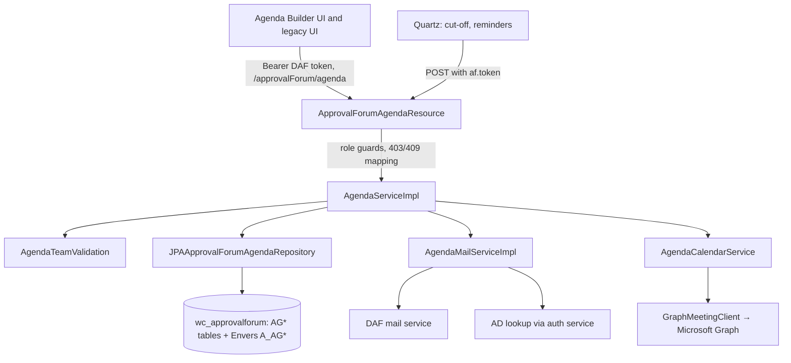

# Agenda API design

## Architecture

The resource is a JAX-RS class on Spring with request scope (`prototype`). Each write endpoint is `@Transactional`, so a refusal inside the service rolls back the whole call. The resource owns authentication and role guards. The service owns state rules, item/committee scope and side effects (mail, calendar, audit). Mail failures are logged and never fail the action. Calendar failures fail the action whenever an event must be cancelled. When sending, they are reported per item.

Exact declarations: [endpoints](api-endpoint-contract.md), [permissions](api-permission-matrix.md), [DTOs](api-data-contract.md), [schema](api-schema-reference.md), [rules](api-rules-reference.md), [notifications](api-notification-reference.md), [settings and jobs](api-configuration-reference.md).

## Access model

Two layers decide every call.

1. **Role guard (resource).** `forbiddenUnless(what, roles…)` checks the caller's DAF roles with `hasAnyRole`. A refusal is `403 {"message": "Only <roles> may <what>"}`.
2. **Scope (service).** These predicates tie the role to the item or committee:

| Predicate | True when |
| --- | --- |
| `isOwner` | caller is the booking analyst or the primary analyst |
| `servesAsSecretary` | caller is the committee's meeting secretary, minute taker or administrator |
| `servesAsChair` | caller is the committee's chair or alternate chair |
| `canView` | owner; or reviewer role and assigned reviewer; or Secretary role and serves as secretary; or Chairperson role and serves as chair; or Approver role and item submitted at least once |
| `decidesFor` | (Secretary role and serves as secretary) or (Chairperson role and serves as chair) |
| `canCaptureOutcome` | same as `decidesFor` |
| `canEditParticipants` | owner while not Held, or `decidesFor` |
| `canChangeSchedule` | item active and Captured/Confirmed/Submitted/Returned/Reviewed, meeting Draft/Compiled, and owner or (reviewer role and assigned reviewer) |
| `canReassignReviewer` | item active and Submitted, meeting Draft/Compiled, and `decidesFor` |
| `decidesForMeeting` / `decidesForCommittee` | `decidesFor` on the meeting's or the committee's own record |
| `canViewDocument` | `canView` on the document's item |
| `canCloseCondition` | `decidesFor` on the condition's item's committee |
| `getMeetingFor` | the meeting with items the caller cannot `canView` reduced to their slot |

`AgendaAccess` carries only "holds Secretary / Chairperson / reviewer / Approver". A role counts there only while it is listed in `af.agenda.oversight.roles`. Training and UI language speak of Credit analyst, Review analyst and Approver with secretariat duties. The technical roles above stay unchanged.

The resource applies the scope after the role: committee administration and every meeting action need `decidesFor` the committee; re-open and unlock need it for the item; approve and reject need it unless the caller holds the Approver role; return and download need `canView`; closing a condition needs `canCloseCondition`; the two job endpoints accept only `af.scheduler.user`.

Separation of duties is a third, role-independent check: `AgendaTeamValidation.requireIndependentReviewer` refuses any review, approval, rejection or document decision by the item's booking or primary analyst.

## State machines

### Agenda item (`AGI.ItemStatus`)

| From | Action | To | Conditions (beyond role/scope) |
| --- | --- | --- | --- |
| — | book | Captured | requirements 5.x |
| Captured | upload completes every required type | Confirmed | — |
| any | link docstash document | Confirmed | meeting not Held/Closed (G7) |
| Captured, Confirmed, Returned | submit | Submitted | requirement 9.2 |
| Submitted | return | Returned | reason; meeting not Held |
| Reviewed | upload any document | Submitted | — |
| Submitted | complete review | Reviewed | requirement 9.6 |
| Reviewed | approve | Approved | requirement 9.7; renumber |
| Reviewed | reject | Rejected | reason; event cancelled |
| Submitted, Reviewed, Approved, Rejected | re-open | Confirmed if required types present, else Captured | reason; event cancelled; renumber if was Approved |
| any (meeting not Held) | remove | Removed | event cancelled; renumber if was Approved |
| Captured (past cut-off) | cut-off job | Removed | actor `SYSTEM` |

Editable statuses (`updateItem`): Captured, Confirmed, Returned. Schedule/roster may change in Captured, Confirmed, Submitted, Returned and Reviewed while the meeting is Draft or Compiled.

### Meeting (`AGM.Status`)

| From | Action | To | Conditions |
| --- | --- | --- | --- |
| — | create / first booking | Draft | date not past, committee effective, unique per committee and date |
| Draft (or legacy Compiled/Locked) | update | same | not Held/Closed/Cancelled; invitations auto-updated |
| Draft, Compiled, Locked | cancel | Cancelled | reason; every event cancelled first |
| Cancelled | reinstate | Draft | reason ≤ 1,000; invitation state cleared |
| Draft, Compiled, Locked | mark held | Held | sitting ended |
| Held | close | Closed | every approved item signed off with a decision |
| Closed | re-open | Held | reason; recorded as override |

`Compiled` and `Locked` come from the retired compile/lock workflow. No endpoint sets them any more. `Locked` still blocks booking, edits, uploads, submit and participant changes on old rows. `Preliminary` appears only in the job queries.

### Other states

| Record | States | Rules |
| --- | --- | --- |
| Document version | Pending → Accepted or Rejected; any → Superseded on a newer upload of its type | decisions final; same decision repeated is a no-op |
| Quorum exception | none/Declined → Requested → Approved or Declined; Approved directly when the decider books or submits with a reason | requirement 7.x |
| Post-meeting record | unlocked → locked when the chair sign-off is recorded → unlocked by the committee's Chairperson/Secretary | edits only while unlocked and meeting Held; a sign-off is recorded as the caller at the server's time and never overwritten |
| Condition | Open (or any other client status except Closed/Waived) → Closed or Waived with comments | by the committee's secretariat or chair, while the meeting is not Closed; closed rows ignored by bulk save |
| Booking draft | active → inactive on delete or on booking from it | owner only |

## Invitations

One Graph event per approved item (BR-013). Key properties:

- **Attendees:**
  - the item's participants (participant rows, else the legacy roster)
  - its attendee e-mails
  - the committee's standing roles: chair, alternate chair, meeting secretary, minute taker and administrator

  User ids resolve through AD to mail addresses.
- **Change detection:** a SHA-256 over the committee title, the slot, the invitation HTML, the sorted attendees and the current credit-paper ids/versions/filenames. An item is (re)sent only when this differs from `AGI.InvitationSnapshot`. `invitationNeedsUpdate` on the meeting and each item exposes this to the UI.
- **Delivery:** `createOrUpdateEvent` per item. The event key is `item:<agiId>`. The Graph `transactionId` is a name-based UUID of `<af.agenda.ui.base>:<clientId>:<key>`, so a retried create cannot duplicate an event. After a reinstatement, `cancelledOn` changes that key so a cancelled event is never reused. Attachments are replaced on every update (files under 3 MB in one request, larger ones through an upload session).
- **Outcome:** per item Sent, Updated, Unchanged, Skipped or Failed. Nothing is recorded for a failed item. If every attempted item failed, the call is refused with the generic failure. Partial success is returned with the results.
- **Leaving the agenda:** reject, re-open and remove cancel the item's event before changing state. A meeting cancellation cancels every event first. Failure keeps everything as it was.
- **Legacy:** `AGM.GraphEventId` and related columns belong to the retired meeting-wide event. They are still cancelled with the meeting and cleared on reinstatement.

## Time rules

| Rule | Value |
| --- | --- |
| Meeting start default | 08:00 |
| Meeting end | start + committee default duration, else 240 minutes, capped at 23:59 |
| Cut-off | last configured weekday strictly before the meeting date at the configured time; default Thursday 17:00; the cut-off job runs hourly |
| Booking horizon for available dates | three weeks |
| Slot | `HH:mm` start + positive duration, ending by 23:59; overlap tested against start to max(end, start + minutes) |
| Sitting ended | meeting date + end time, else start time, else the next midnight |
| Reminder window | cut-off one or two days ahead |

Times are wall-clock strings (`HH:mm`). Graph events use the time zone `South Africa Standard Time`.

## Data model

| Table | Holds |
| --- | --- |
| `AGC_AgendaCommittee` | committee and mandate level, quorum size and roles, meeting day, cut-off rule, required document types, standing roles (names and ids), list name, effective window, defaults |
| `AGM_AgendaMeeting` | one sitting: date, mode, venue, status, cut-off, times, actual times, quorum flag, cancellation and closure audit, legacy lock and event columns |
| `AGI_AgendaItem` | the booking and paper metadata, team (names and ids), slot, legacy roster columns, attendee e-mails, status, agenda number, lateness, quorum exception, per-item invitation state |
| `AGP_AgendaParticipant` | participants per item with role, eligibility flags, planned and actual attendance |
| `AGID_AgendaItemDocument` | document versions with bytes, type, version, validation decision |
| `AGW_AgendaWorkflowAction` | audit trail per item and/or meeting |
| `AGPM_AgendaPostMeeting` | decision, actuals, sign-offs and lock per item |
| `AGCA_AgendaCondition` | conditions and actions per item |
| `AGMR_AgendaMeetingRecord` | minutes, transcripts and pack references per meeting |
| `AGN_AgendaNotification` | e-mail log |
| `AGBD_AgendaBookingDraft` | the booking form's saved state per owner |

Identifiers are integers (`agcId`, `agmId`, `agiId`, `agidId`, `agcaId`, `agbdId`, `agpId`). Rows are soft-deleted with `Active`. Audited entities have Envers tables `A_<table>`.

## Errors

| Situation | Answer |
| --- | --- |
| Business rule | 409 `{"message"}` from `IllegalStateException` |
| Role or scope (including the committee the caller serves, a document's item, a condition's item, the scheduler user) | 403 `{"message"}` |
| Missing `approved` on a quorum decision | 400 `{"message"}` |
| Unknown or foreign draft | 404 `{"message"}` |
| Missing download | 404 |
| Counterparty feed failure | 500 with the external message as reason |
| Unknown id elsewhere, malformed multipart | unmapped server error (G13, G14) |

Messages are user-facing. The UI shows 409 messages as they are.

## Legacy mirror

`reviewmandates/approvalforum` carries the same agenda service, resource and tests for the legacy deployment. Behaviour changes here are mirrored there. The legacy UI calls the same endpoints.

## Verification

| Requirements | Evidence in `api/src/test` |
| --- | --- |
| 1–2, 9, 12 resource guards | `ApprovalForumAgendaResourceTest`, `AgendaAccessTest` |
| 3–5, 9–13 service rules | `AgendaServiceImplBrsTest`, `AgendaServiceImplCoverageTest`, `AgendaBookingSlotTest`, `AgendaScheduleChangeTest`, `AgendaQuorumExceptionTest`, `AgendaMeetingPapersTest` |
| 1.6–1.8, 2.6–2.8, 13.2, 13.7 scope rules and settings | `AgendaServiceImplScopeTest`, `ApprovalForumAgendaResourceTest`, `ApprovalForumWebResourcesModuleTest` |
| 6 | `AgendaTeamValidationTest` |
| 14 | `AgendaMailServiceImplTest`, `AgendaMailServiceImplCoverageTest` |
| 11 Graph transport | `GraphMeetingClientHttpTest` |
| Generated references | `python api/tools/document-agenda-api.py --check` |

Unit tests use mocks. They are not evidence of Graph, AD, mail delivery or the database in an environment.
